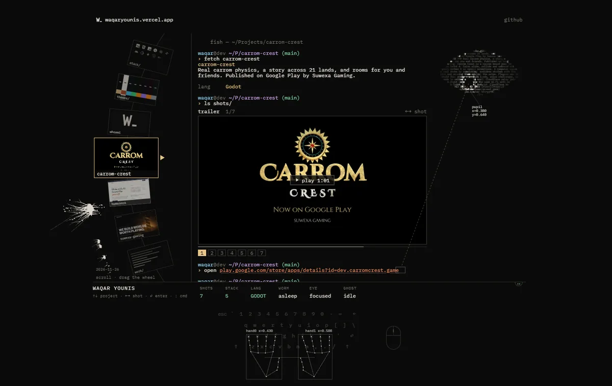
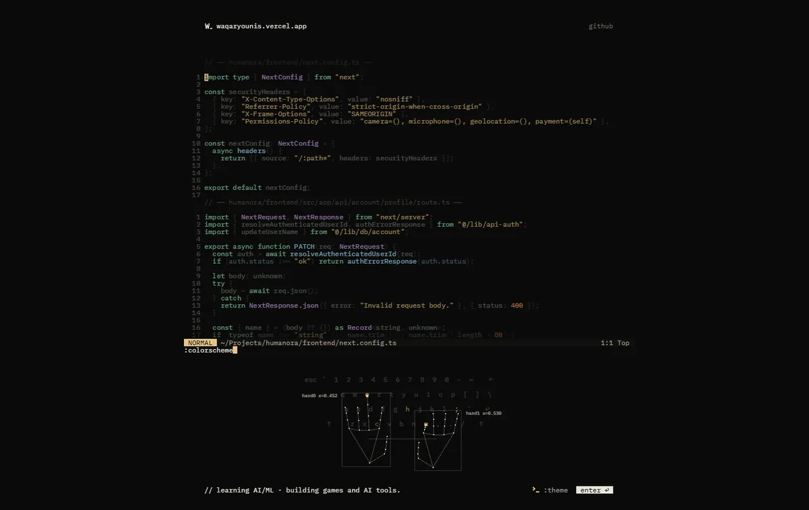

# Waqar Younis · portfolio

My developer portfolio, live at **[waqaryounis.vercel.app](https://waqaryounis.vercel.app)**.



I'm a BCA student at Manipal University Jaipur working toward a career in AI/ML, and the founder of Suwexa Gaming. The site shows what I've shipped so far:

- **[Carrom Crest](https://play.google.com/store/apps/details?id=dev.carromcrest.game)**: a carrom game for Android, on Google Play
- **[Humanora](https://humanora-beryl.vercel.app)**: an AI writing and study workspace built on Google Gemini
- **[Suwexa Gaming](https://suwexa.vercel.app)**: my studio's website, with a carrom table you can play in the browser

## How it works

Plain HTML, CSS and JavaScript, no framework and no build step, styled like the Neovim editor.

- All content lives in [`portfolio.config.json`](portfolio.config.json).
- [`scripts/build-data.mjs`](scripts/build-data.mjs) turns it into the JSON files the site reads.
- A [weekly GitHub Action](.github/workflows/refresh-github-stats.yml) refreshes the contribution calendar, languages and code wall from the GitHub API.
- Hosted on Vercel, which redeploys on every push to `main`. Security headers are set in [`vercel.json`](vercel.json).



## Run it locally

```sh
python serve.py                              # http://localhost:8767
node scripts/build-data.mjs                  # after editing portfolio.config.json
node scripts/build-data.mjs --fetch-github   # also refresh GitHub data (needs the gh CLI, signed in)
```

`serve.py` sends the same security headers as production, so a policy problem shows up locally first.

## Credits

Built on [dev-portfolio-template](https://github.com/pavanjoshi914/dev-portfolio-template) by Pavan Joshi (MIT licence). I personalised it with AI-assisted development (Claude Code) and added Windows support in the build script, playable video trailers for projects, social preview cards, security headers and the weekly stats refresh.

## Licence

MIT. See [LICENSE](LICENSE), which keeps the original template's copyright notice.
